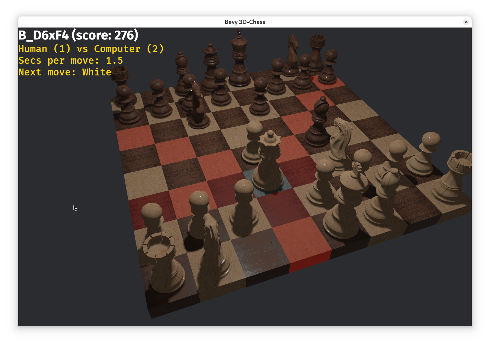

# Bevy 3D Chess



**Version:** 0.3 — *07 NOV 2026*
**Author:** Dr. Stefan Salewski
**License:** See source file headers for attribution of 3D models.

A **plain Bevy 0.20.1 front end** for the **tiny Salewski chess engine**, featuring:

* **Fully 3D chessboard and pieces**
* **Mouse-based camera control** (orbit, pan, zoom) via `bevy_panorbit_camera`
* **Piece hover highlights** — pieces change color when the mouse is over them
* **Legal move highlights** — click a piece to show all valid destination squares
* **Last move highlights** — marks both source and destination squares after each move
* **Basic UI overlay** with help text, turn info, time control, and next player
* **Engine integration** — supports human vs. computer play with configurable time per move

---

## 📦 Requirements

* Rust 1.97.1+ (2024 edition)
* Bevy 0.20.1

---

## 🔧 Build & Run

```bash
git clone https://github.com/stefansalewski/Bevy-3D-Chess.git
cd Bevy-3D-Chess
RUST_LOG=off cargo run
# Or build and run an optimized version:
cargo run --release
```

---

## 🎮 Controls

* **Left-click** — Select a piece, then click a destination square
* **Middle mouse** — Rotate/orbit camera
* **Right-click** — Pan camera
* **Mouse wheel** — Zoom in/out
* **Keypad 1 / 2** — Toggle human/computer control for each side
* **Keypad +/-** — Adjust engine move time
* **Keypad 0** — Start a new game
* **M** — Print move list to console (initially for engine debugging)

---

## 🎨 Graphics

The chess pieces were created in Blender by **Bhargav Limje** and are licensed under [Creative Commons Attribution](http://creativecommons.org/licenses/by/4.0/).
Board asset: [Wooden Chess Board](https://skfb.ly/oXqwI).

The graphics had some issues: the white king's texture was rotated by 90 degrees, and Bevy reported warnings such as `Unknown vertex attribute TEXCOORD_2`. The GPT-6 Terra Codex agent helped fix these issues.

---

## ⚠ Known Limitations

* Highlight cache is simplified — highlighted materials are recreated instead of fully reusing precomputed variants
* Hover highlighting for pieces works, but **legal move square highlights disappear** when moving the mouse after selection *(planned fix)*
* No coordinate labels, arrows, or other board annotations yet *(future feature)*

---

## 📦 Model Credits

Models are loaded from `.glb` assets under Creative Commons licenses:

* **"Chess Scene Pieces / Blender"** — [moyicat](https://skfb.ly/67OF8)
* **"Realistic 3D Chess Pieces (Blender)"** — [ronildo.facanha](https://skfb.ly/oXTUP)
* **"Chess"** — [xnicrox](https://skfb.ly/6uVLu)
* **"Wooden Chess Board"** — [Bhargav Limje](https://skfb.ly/oXqwI)

---

## 📜 Project Status

Bevy 3D Chess started as a Bevy learning exercise — originally built for Bevy 0.14 and now updated to **Bevy 0.20.1**.
The GUI code borrows heavily from Bevy example projects. GPT-5 assisted in updating the code and implementing highlight effects for both squares and pieces.

---

## 🔀 Alternative Implementations

The same chess engine code is also available with:

* **Xilem UI** — [xilem-chess](https://github.com/StefanSalewski/xilem-chess)

Older Nim, GTK, and blocking Egui versions are now deprecated and will be removed.

---

## 💬 Feedback

This is an **intermediate release**. Feedback from the Bevy community is especially welcome on:

* Efficient material handling for hover/selection highlights
* ECS patterns for updating squares and pieces
* UI enhancements for move history, timers, and game state

## Bugs

* The engine can consider promotion to a knight, but moves are always applied as promotions to a queen. In rare positions, the engine may therefore evaluate a different move from the one played.

## AI and Other Support

* The engine was created manually from scratch. Various AI tools have helped implement Bevy features, such as highlights for pieces and legal moves. The GPT-6 Terra Codex agent added mesh replacement for pawn promotion and fixed an issue with invisible pieces during the update from Bevy 0.18 to 0.20.1.

* Special thanks to **ajundi** for reporting an issue with starting a new game after checkmate. Their report motivated me to revisit the app and fix several small issues, including castling, en passant, pawn promotion, and the "moves to checkmate" messages.


---


